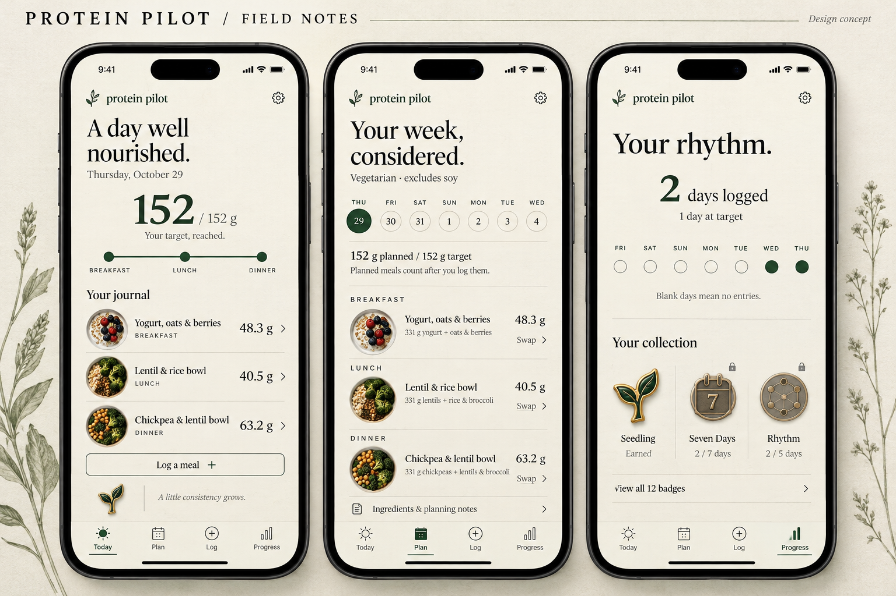
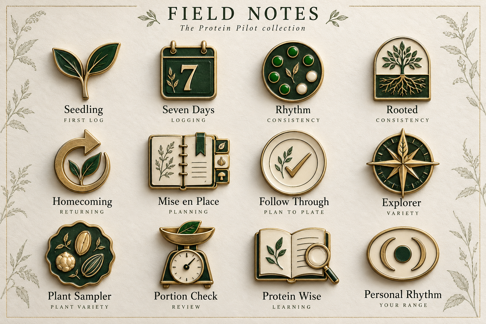

# Protein Pilot — Field Notes

Design proposal, 29 October 2026. The automatic planner is implemented and tested; this visual redesign and named badge system are proposed, not yet installed in the app. Screens and badge images are art-direction concepts, not production screenshots.

## The interface

Use ivory (#F5F1E8), forest (#244735), ink (#20251F), muted brass (#A88A50), and a quiet warm neutral for separators. Brass is an accent, never low-contrast body text. Serif display headings paired with a humanist sans-serif for controls, amounts, and explanatory copy. Keep body text at least 16 pt, respect Dynamic Type, use tabular numerals for nutrition, and retain 44 pt minimum touch targets. Confirm actual font availability/licensing when implementing.

- **Today:** one dominant daily protein number, a compact status line, then a journal of meals. Meal photographs belong inside the journal, with a designed placeholder when unavailable. No stock pantry scene behind text. The main action is “Log a meal.” The example uses the tested 48.3 + 40.5 + 63.2 = 152 g day. In production the more accurate headline is “Your food, recorded.” rather than implying that meeting a protein estimate proves adequate nourishment.
- **Plan:** a seven-day strip, planned-versus-target summary, and three readable meal sections. Each shows its real adjusted portions and a swap action. Selecting a meal opens ingredients and the explicit review/log action. A swap preview shows which other portions will change before confirmation. A changed profile produces a clear rebuild state; an infeasible plan explains the constraint without changing it. Planning notes use a disclosure, while an active restriction conflict stays visible.
- **Progress:** separate logging consistency from protein totals. Blank dates stay unknown. A compact calendar appears above the collectible badge shelf. Show the next realistically reachable badge and an “All badges” collection; never use a leaderboard of grams eaten. The concept's two logged days and one day at target reflect the tested account. Range tabs remain available; lifetime badge progress does not reset when the chart range changes.

The botanical edge illustrations in the presentation are board decoration, not full-screen backgrounds. Production badges need simplified silhouette variants for 24/32 px, detailed variants for 64/96 px, and a 240 px celebration version. Generated food photos and pin artwork are concept references; final recipe photos must match their actual ingredients, and badges must be redrawn/exported individually.

## Full collection and exact rule version 1

These are proposed product rules, not clinically validated thresholds. “Logged day” means a stored local calendar day containing at least one non-deleted, server-confirmed meal with positive food quantity. A draft, photo upload, recipe favorite, or plan is not a logged meal. Thresholds count evidence, not promises about diet quality.

| Badge | Exact earning criterion | Evidence / release |
| --- | --- | --- |
| **Seedling** | First non-deleted, server-confirmed meal. No minimum protein required. | Existing meals; release 1. |
| **Seven Days** | Meals logged on **7 distinct local dates**, lifetime. They need not be consecutive. | Existing meal days; release 1. |
| **Rhythm** | At least **5 distinct logged dates within any 7 consecutive local calendar dates**, endpoints included. | Existing meal days; release 1. |
| **Rooted** | At least **20 distinct logged dates within any 28 consecutive local calendar dates**. | Existing meal days; release 1. |
| **Homecoming** | A new logged date after **at least 3 complete intervening dates with no entries**, with at least one earlier logged date. Example: Monday then Friday qualifies; Monday then Thursday does not. | Existing meal days; release 1. A gap means missing records, not that the person did not eat. |
| **Mise en Place** | Save **one valid 7-day generated plan** containing breakfast, lunch and dinner on all seven dates, matching current restrictions; every day's stored estimated protein is **target through target + 1 g**. Rebuild/retry counts once. | Plan audit event/snapshot; release 1. Clearly labeled a planning award. |
| **Follow Through** | On **one local date**, confirm meals from **3 distinct planned slots** for that same date: breakfast, lunch, dinner. Edits to the portions are allowed; all three must remain confirmed and non-deleted. | Add server-validated planId/slotId provenance to meals; release 2. Matching names alone is insufficient. |
| **Explorer** | Log **5 distinct canonical protein-food IDs in any 14 consecutive local dates**; each must contribute **at least 5 g protein within one confirmed meal**. Repeated recipes/brands of the same food ID count once. | Verified source IDs and nutrient records; release 2. The 5 g threshold filters trivial garnishes, not a health threshold. |
| **Plant Sampler** | Log **3 distinct plant source families in any 14 consecutive local dates**; each contributes **at least 5 g protein in one confirmed meal**. Families: lentils, chickpeas, other beans/peas, soy, nuts, seeds. Tofu and edamame both count as soy. | Verified taxonomy; release 2. Optional; never recommend a restricted ingredient to pursue a badge. |
| **Portion Check** | Confirm **3 distinct photo-analysis meals**, each with an explicit “I checked the portion” event tied to the confirmed draft version. An unchanged estimate may qualify; changing a number is not required. | New explicit review event; release 2. This recognizes review, not measured accuracy. |
| **Protein Wise** | Complete **all 3 fixed knowledge checks correctly**: photo portions are estimates; protein quality involves digestibility and amino acids and cannot be measured from a photo; a high protein-to-calorie ratio is not universally a better food choice. No time limit; retries allowed. | Versioned educational module and completion record; release 2. Human-reviewed answers, no model-only grading. |
| **Personal Rhythm** | On **5 distinct user-marked-complete dates within any 7 consecutive dates**, logged protein is **90–110% inclusive of that date's saved calculated target**. Target must be positive and supported (`ready` guidance); apply historical targets. Partial/missing days never qualify. | Day-completion flag and reviewed range-based achievement; release 3. Opt-in. The range is a proposed product tolerance, not a medical safe range; no extra credit above it. |

### Shared mechanics

- Earn each badge once per account and rule version. Store qualification date, supporting meal/event IDs, rule version, and the relevant historical target/restriction snapshots. Do not award from transient client state.
- Offline activity qualifies after server confirmation. Retries, duplicate sync, and repeated rebuilds do not increment counts. Freeze the journal day assigned at saving; timezone changes cannot create extra days from the same meal. Date edits trigger recomputation.
- Rolling-window achievements remain earned after the window passes; missed days do not remove awards. If supporting records are corrected/deleted, recompute the historical qualification and update quietly when evidence no longer qualifies. Keep a deduplicated award ledger so repeated edit/undo never replays a celebration.
- No points for exceeding protein targets, minimizing calories, weight loss, longer fasting, or purported photo-derived bioavailability. Clinical restriction, pregnancy/breastfeeding and other unsupported profiles can still earn non-target badges. Never lower allergy constraints to unlock a badge.
- Locked badges show an outline, their exact rule and factual progress. Available, in-progress and earned use shape/text as well as color. A new award uses one short reveal and one optional haptic; Reduce Motion uses a static reveal. No loss warnings or notifications claiming the user failed to eat.
- The current app has period counts, not a lifetime award ledger. None of these twelve named badges should be represented as already implemented.

## Motion and integrations researched

Reviewed official documentation on 29 October 2026. These are recommendations for implementation, not new dependencies installed for the mockups.

1. **Reanimated:** first choice for measured card expansion, number transitions, and brief badge reveal; use the reduced-motion support. Avoid experimental shared-element transitions as a core dependency. [Official documentation](https://docs.swmansion.com/react-native-reanimated/docs/fundamentals/getting-started/).
2. **Expo GlassEffect:** optionally use a small native glass navigation surface on iOS 26+, with a deliberate opaque fallback. Keep food and nutrition text on opaque ivory. Expo SDK 58 documents Expo Go support and fallback to a regular View on unsupported platforms. [SDK 58](https://docs.expo.dev/versions/v58.0.0/sdk/glass-effect/). Apple's guidance positions this material around controls/navigation and accounts for accessibility settings. [Apple materials](https://developer.apple.com/design/human-interface-guidelines/materials).
3. **Rive:** appropriate only if the badge reveal needs designer-authored interactive states. The current recommended package is `@rive-app/react-native`, replacing legacy `rive-react-native`; it depends on Nitro Modules. Prototype in a development build and check the RN 0.88 requirements before committing. Start with static SVG/PNG badges plus Reanimated if sufficient. [Rive runtime](https://rive.app/docs/runtimes/react-native/react-native).
4. **Skia:** reserve for a custom interactive progress visualization or subtle pin lighting; it integrates with Reanimated on the UI thread. It is unnecessary for a static calendar or simple badge grid. [Official repository](https://github.com/Shopify/react-native-skia) and [animation documentation](https://wcandillon.github.io/react-native-skia/v2/docs/animations/animations/).
5. **Bottom sheets:** recipe swaps and portion review are good candidates. Gorhom provides gesture, keyboard and accessibility features, but its documentation's version-compatibility claims need an SDK 58 smoke test before adoption. Also evaluate native Expo Router sheet presentation during the planned navigation cleanup. [Gorhom documentation](https://gorhom.dev/react-native-bottom-sheet/).

### Why this feels designed

Use a consistent type hierarchy, art-directed photographs, recognizable badge silhouettes, accurate number formatting, purposeful empty/error states, and motion that explains changes. Those decisions matter more than adding many libraries. Keep the badge's physical material treatment as the signature detail; the rest of the interface should be quiet and legible.

## Implementation sequence and acceptance

1. Translate these three concepts into editable Paper screens and a component/token sheet. Include loading, empty, stale-plan, restriction-error, offline and large-text variants; do not treat the raster concept as implementation-ready UI.
2. Build the Field Notes shell and reusable meal row, daily summary, date strip, plan notes disclosure and badge tile. Retain current data flows; migrate navigation deliberately instead of adding a parallel navigation system.
3. Implement the server award ledger and release-1 rules. Unit tests at threshold minus one/exact threshold, missing days, month/year/DST boundaries, deletion/undo, offline duplicates, cross-user access and target changes.
4. Add provenance/review events and verified food taxonomy before release-2 badges. Complete the human-reviewed learning module. Do not infer review events from edits or taxonomy from an unreviewed image model.
5. Add explicit day completion and review the product rationale before enabling Personal Rhythm. Test unsupported-guidance exclusion and historical targets.
6. Redraw/export all pins consistently, test 32 px recognizability, add one restrained celebration, and validate VoiceOver, Dynamic Type, Reduce Motion, contrast, older-device frame time and Android fallback in addition to iOS Simulator.

## Assets

- `field-notes-screens.png`: Today, Plan, Progress concepts.
- `field-notes-collection.png`: full twelve-pin collection.
- `concept-directions.png`: earlier three-direction exploration; Field Notes selected.
- `prompts.json`: generation specifications. Built-in image generation used; no new API key created.

## Nutrition evidence boundaries

Variety is supported as part of a healthy eating pattern; it does not validate the particular number of foods or days chosen for a badge. [Health Canada: protein foods](https://www.canada.ca/en/health-canada/services/food-guide/explore/healthy-eating-recommendations/eat-variety/eat-proteins.html). Ingredient matching cannot establish freedom from allergen cross-contact. [FDA: food allergies](https://www.fda.gov/food/nutrition-food-labeling-and-critical-foods/food-allergies). None of the badge thresholds is presented as a clinical outcome measure or a proven intervention.
